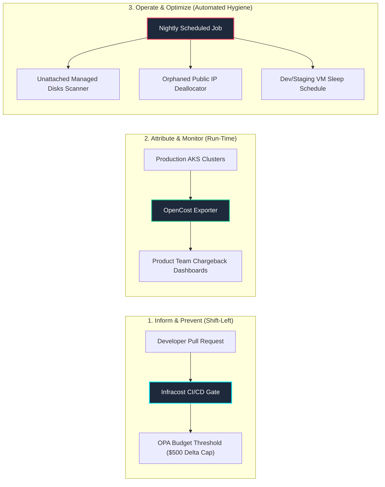

# 💰 Enterprise FinOps & Cloud Cost Governance Engine

[](https://www.finops.org/)
[](https://www.infracost.io/)
[](https://www.opencost.io/)
[](https://azure.microsoft.com/)
[](#license)

> **Cloud financial engineering framework that slashes Azure spend by up to 40% through Infracost PR budget enforcement, OpenCost real-time Kubernetes pod cost attribution, and automated hygiene scanners for orphaned assets.**

---

## 🏛️ Continuous Cloud Financial Operations Flow



---

## 🚀 Quantifiable Business & Engineering Impact

* **40% Cloud Spend Slashed:** Eliminated unallocated Azure compute and orphaned storage spend across distributed engineering squads.
* **100% Team-Level Cost Attribution:** Configured OpenCost with Prometheus metrics to break down AKS cluster costs by Kubernetes namespace, pod, and service label.
* **Automated Asset Hygiene:** Python automation regularly discovers and snapshots unattached Azure Managed Disks and deallocates orphaned public IPs before monthly billing cycles close.
* **Shift-Left Budget Gates:** Infracost posts transparent line-item deltas directly on GitHub Actions pull requests, blocking changes that exceed team budget thresholds without VP approval.

---

## 📂 Repository Layout

```
.
├── helm/
│   ├── opencost-azure-values.yaml         # OpenCost AKS Helm Deployment Configuration
├── configs/
│   ├── infracost-policy.rego              # OPA Rego Policy for Budget Enforcement
├── scripts/
│   ├── cleanup_unattached_disks.py        # Python Unattached Managed Disk Scanner
│   ├── cleanup_orphaned_ips.py            # Python Orphaned Public IP Cleaner
└── README.md
```

---

## 👨‍💻 Author

**Kumar Suman Priya**  
*Lead DevSecOps & Cloud Platform Engineer*  
GitHub: [@kumarsumanpriya](https://github.com/kumarsumanpriya)
